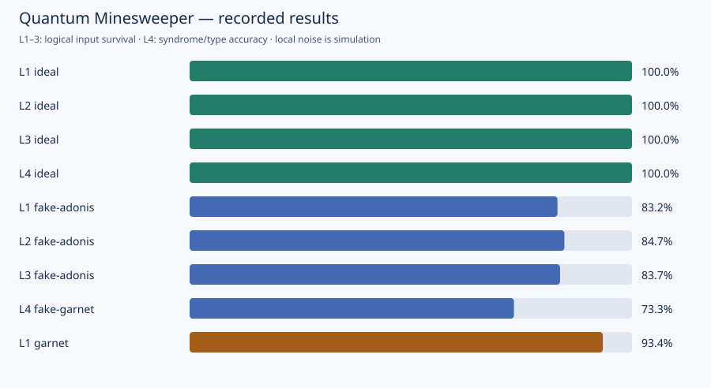

# Recorded challenge results

These numbers are generated from saved raw data. Evidence labels distinguish ideal simulation, local IQM noise models, and actual IQM hardware.

Exact verification: **703 cases**, passed=True. Minimum fidelity 0.999999999999996; minimum expected syndrome probability 0.999999999999996.

For levels 1–3 fidelity means recovered logical/reference fidelity; for level 4 it means preservation of the error-shifted encoded data/reference during syndrome extraction.

| Evidence | Level | Corrected/detection circuits | Mean syndrome accuracy | Mean logical survival | Recovery-disabled survival |
|---|---:|---:|---:|---:|---:|
| ideal-local-simulation | 1 | 24 | 100.0000% | 100.0000% | 83.3333% |
| ideal-local-simulation | 2 | 24 | 100.0000% | 100.0000% | 83.3333% |
| ideal-local-simulation | 3 | 24 | 100.0000% | 100.0000% | 83.3333% |
| ideal-local-simulation | 4 | 78 | 100.0000% | not measured | — |
| iqm-local-fake-noise / fake-adonis | 1 | 8 | 74.1699% | 83.1543% | 77.4902% |
| iqm-local-fake-noise / fake-adonis | 2 | 8 | 73.5840% | 84.7168% | 78.2715% |
| iqm-local-fake-noise / fake-adonis | 3 | 8 | 74.6094% | 83.7402% | 78.5645% |
| iqm-local-fake-noise / fake-garnet | 4 | 13 | 73.3173% | not measured | — |
| iqm-hardware / emerald | 1 | 8 | 94.5801% | 95.4590% | 85.3516% |
| iqm-hardware / garnet | 1 | 8 | 88.8184% | 93.4082% | 84.5703% |
| iqm-hardware / sirius | 1 | 8 | 72.7051% | 78.6133% | 81.2012% |

The chart uses logical input-state survival for levels 1–3 and type/syndrome accuracy for level 4; these are distinct metrics. Values are unweighted circuit means (each recorded suite uses equal shots per circuit).

The ideal suite uses all six cardinal states. The local IQM noisy levels 1–3 and the real Garnet level-1 pilot use |+⟩ and |+i⟩; noisy level 4 uses |+i⟩. These means therefore have different input coverage. All allowed locations and the no-error case are included in each reported level.

Individual binomial confidence intervals, syndrome histograms, and raw counts are in the JSON files. No favorable-syndrome postselection is performed. Aggregate means are descriptive and have no confidence interval attached here.

The local IQM fake backend uses representative gate/readout/relaxation noise and stochastic sampling. It does not use current live-machine calibration. Finite-shot values can vary across runs.

Recovery-disabled controls retain encoding and decoding and omit the final recovery. They illustrate the targeted error model, not a bare-qubit memory benchmark. Extra recovery gates can reduce performance under native noise.

## Actual IQM hardware jobs

- Backend `emerald`, job `01a20234-8532-73f6-90dc-f3a025d72609`: `results/iqm-emerald/results.json`.
- Backend `garnet`, job `01a1ffa5-97e8-77e2-ac14-9a55f2083731`: `results/iqm-pilot/results.json`.
- Backend `sirius`, job `01a20232-ba40-74f0-9633-3d669a73cf7b`: `results/iqm-sirius/results.json`.

See `docs/HARDWARE_RESULTS.md` for the pilot's complete per-configuration comparison and limitations. Hardware evidence currently covers level 1; levels 2–4 are verified in simulation.
