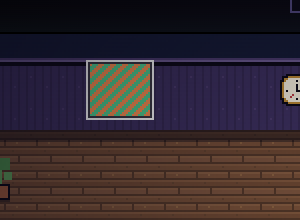

# Art Replacement Guide

Every sprite in the game is an **original procedural placeholder** drawn in code. You can replace any of them by dropping a PNG into `public/assets/…` — **no gameplay code changes are needed**. Click targets, collisions, the white hover outline, 0/1 logic, story flags and rewind state all keep working.

*Above: the smoke test dropped a garish test PNG at `public/assets/sprites/objects/window_open.png`; the white hover outline was generated from the new art automatically.*

## The 60-second workflow

1. Run `npm run dev`.
2. Save a **transparent PNG** at the path listed for that asset ID in the table below (same size if you can).
3. The dev server notices the new file and reloads the page by itself. The file is picked up with a cache-busting version, so you never see a stale image.
4. Open `http://localhost:5173/?debug=1`, press `` ` `` (backtick) to show hitboxes, and hover your object:
   - yellow box = clickable hitbox, orange box = collision footprint, faint teal = keyboard reach, cyan = door trigger;
   - the debug panel's **world** tab shows the hovered object's ID, texture ID and file path.
5. Check that the white outline hugs your art, the object sorts correctly in front of and behind the player, and animation frames look right.
6. If the art is a different size or needs to sit somewhere else, edit **only** its coordinates in `src/data/roomLayouts.ts`. If you want a different file path, edit **only** its `url` in `src/assets/manifest.ts`.

If a file is missing or fails to load, the procedural sprite is used instead and the room keeps working. The debug panel's **world** tab lists any failures.

## How it works (so you can trust it)

- `src/assets/manifest.ts` is the **typed semantic asset manifest**: stable ID → optional file URL, size, frame grid and anchor.
- A tiny Vite plugin (`vite.config.ts`, `virtual:asset-files`) lists the files that actually exist in `public/assets`, so the game only requests real files. You get no 404 spam, and adding or removing a file hot-reloads the page.
- `src/game/scenes/BootScene.ts` loads the existing files and draws procedural fallbacks (`src/assets/procedural.ts`) for the rest.
- `src/game/interactable.ts` is the single reusable interaction component. It builds the **white outline ring + translucent silhouette from your texture's alpha at runtime**, on a separate overlay layer, so replacement art inherits the highlight for free. Locked gadgets get a dimmer, grey-white outline.
- **Hitboxes and collision footprints are defined in `src/data/roomLayouts.ts`, not derived from the art.** Swapping a 32×28 window for a 40×40 one never moves an invisible trigger.
- Gameplay code refers only to IDs such as `obj.closet.ajar`. Nothing imports a PNG path directly.

## Conventions

| Topic | Convention |
|---|---|
| Format | Transparent PNG, 8-bit RGBA, no premultiplied halos |
| Grid | 16×16 px tiles; logical screen is 512×288 (32×18 tiles), scaled by whole numbers with nearest-neighbour |
| Sizes | Multiples of 16 where possible (sizes in the table are what the layout was designed around) |
| Anchor | Floor furniture: **bottom-centre** (0.5, 1). The layout's `x, y` is the object's "feet". Taller art grows upward. Wall items are anchored the same way at their bottom edge. |
| Outlines | 1–3 px dark outline (`#0a0814`), soft 1–2 px drop shadow at the base |
| Palette | midnight navy `#141a33`, deep `#0d1024`, dusty purple `#4a3a6b` / `#6b5a8e`, teal `#2f8f8a` / `#5fd3c4`, lamp gold `#f2c46d` / `#b8862f`, off-white `#f1ead8`, rose `#e46b8f`, cyan `#6ff3ff` (`src/assets/palette.ts`) |
| Physical states | Every household sensor has one PNG **per physical state** (e.g. `window_open.png`, `window_closed.png`). Make the two states differ in **shape**, not only colour, for colour-blind players (inspection text also describes the difference). |
| Echo shimmer | `*_unresolved.png` is optional. If absent, it is composited automatically from both states with cyan/rose ghosting. |

### Player sprite sheet (`public/assets/sprites/player.png`)

64×96 px = 4 columns × 4 rows of 16×24 frames.

| Row | Direction | Columns |
|---|---|---|
| 0 | walk down (facing camera) | 0 stand · 1 step · 2 stand · 3 step |
| 1 | walk left | same |
| 2 | walk right | same |
| 3 | walk up (back) | same |

You can add more walking frames by widening the sheet (keep 4 rows) and changing `width`/`frameWidth` in the manifest. The animation reads frames per row from the texture automatically. The collision box always sits at the feet, so a taller character works.

## Photos (only shown when examined)

Photos never appear on the walkable map. They open in a large modal (zoom with click, close with Esc) when a frame or paper is clicked.

| Hotspot | File | Notes |
|---|---|---|
| Right bedroom portrait | `public/assets/photos/james.jpg` | James's photo. The scratched clue **"RR = third"** is drawn *over* the image, so replacing the photo never removes the clue. |
| Left bedroom frame | `public/assets/photos/dorm.jpg` | Overlay: "the window never closes" |
| Left bedroom clipping | `public/assets/photos/clipping.png` | Overlay: the clue text |
| Right bedroom poster | `public/assets/photos/poster.png` | |
| Projector (after the prism) | `public/assets/photos/projector.jpg` | Overlay: the binary mailbox clue |
| Sticky note | `public/assets/photos/sticky.png` | Overlay: "Nobody lives at address zero." |

Paths, captions, alt text and overlay positions live in `src/data/photos.ts`. Any web image format works; keep it under about 2 MB. If a file is missing, a designed placeholder renders.

## Portraits, fonts, colours, audio

- **Dialogue portraits:** `public/assets/portraits/james.png` (64×64 recommended, shown at 76 px, pixelated). Falls back to an original pixel face.
- **UI colours and fonts:** `src/theme/tokens.css` (CSS variables `--c-*`, `--font-title`, `--font-body`, sizes). Fonts are bundled from Fontsource (OFL) and imported in `src/main.tsx`. To swap one, install another `@fontsource/*` package (or drop `.woff2` files in `src/theme/` with an `@font-face`) and change the two font variables. Never load fonts from a CDN: the game must work offline.
- **Ambient music:** drop `public/assets/audio/ambient.mp3` to replace the synthesized drone. Quantum notes stay synthesized, because their pitch, timbre and length *are* the puzzle.

## Changing scenery without moving triggers

- Recolour or redraw freely: same file path, any art.
- Move furniture: change `x, y` in `roomLayouts.ts`. Its `hit` and `solid` boxes move with it.
- Make something bigger: also bump its `hit: [w, h]` and `solid: [w, h]` if the new footprint should block or be clickable over a larger area.
- Add a non-interactive decoration: add `{ id: 'deco.x', asset: 'deco.x', x, y, layer: 'y', decor: true }` plus a manifest entry. Decor **never** glows or gets a hitbox.
- Doors: the door *sprite* and the walk-through *trigger* (`doors: [...]`) are separate entries. Keep the trigger inside the wall gap (`gaps`).

## Licences and credits for external art

The repo currently ships **no third-party art or audio** and no Undertale (or any other game's) assets. If you add external art, record its author, source URL and licence in the README **Credits** section (and in the in-game credits in `src/ui/Ending.tsx`). Only use art you made or art under a licence that allows redistribution (CC0, CC-BY with attribution, OFL for fonts).

## Complete asset inventory (generated from the manifest)

Regenerate this table at any time with `npx tsx scripts/asset-table.ts`.

| Asset ID | Category | File to add/replace | Size (px) | Anchor | What it is / state |
|---|---|---|---|---|---|
| `player` | player | `public/assets/sprites/player.png` | 64×96 (frames 16×24) | 0.5, 1 | Player character, 4 directions x 4 walking frames. Rows: 0=walk down, 1=walk left, 2=walk right, 3=walk up. Columns 0..3 = walk cycle (0 and 2 are standing poses). |
| `tile.floor.wood` | tile | `public/assets/sprites/tiles/floor_wood.png` | 16×16 | 0, 0 | Common room wooden floorboards |
| `tile.floor.left` | tile | `public/assets/sprites/tiles/floor_left_carpet.png` | 16×16 | 0, 0 | Left bedroom carpet (dusty purple) |
| `tile.floor.right` | tile | `public/assets/sprites/tiles/floor_right_carpet.png` | 16×16 | 0, 0 | Right bedroom carpet (teal) |
| `tile.floor.hall` | tile | `public/assets/sprites/tiles/floor_hall.png` | 16×16 | 0, 0 | Foyer / hallway tiles |
| `tile.floor.vault` | tile | `public/assets/sprites/tiles/floor_vault.png` | 16×16 | 0, 0 | Vault room stone |
| `tile.rug` | tile | `public/assets/sprites/tiles/rug.png` | 16×16 | 0, 0 | Rug tile (gold-trimmed) |
| `tile.wall` | tile | `public/assets/sprites/tiles/wall_face.png` | 16×16 | 0, 0 | Wall face (wallpaper) |
| `tile.wall.cap` | tile | `public/assets/sprites/tiles/wall_cap.png` | 16×16 | 0, 0 | Top edge of a wall |
| `tile.wall.side` | tile | `public/assets/sprites/tiles/wall_side.png` | 16×16 | 0, 0 | Side / bottom wall block |
| `obj.window.closed` | sensor | `public/assets/sprites/objects/window_closed.png` | 128×44 | 0.5, 1 | Common-room window (CAT): closed |
| `obj.window.open` | sensor | `public/assets/sprites/objects/window_open.png` | 128×44 | 0.5, 1 | Common-room window (CAT): open |
| `obj.window.unresolved` | sensor | `public/assets/sprites/objects/window_unresolved.png` | 128×44 | 0.5, 1 | Common-room window (CAT): unresolved (optional; auto-composited from both states if absent) |
| `obj.closet.latched` | sensor | `public/assets/sprites/objects/left_closet_latched.png` | 32×44 | 0.5, 1 | Left closet (I1): latched |
| `obj.closet.ajar` | sensor | `public/assets/sprites/objects/left_closet_ajar.png` | 32×44 | 0.5, 1 | Left closet (I1): ajar |
| `obj.closet.unresolved` | sensor | `public/assets/sprites/objects/left_closet_unresolved.png` | 32×44 | 0.5, 1 | Left closet (I1): unresolved (optional; auto-composited from both states if absent) |
| `obj.trash.empty` | sensor | `public/assets/sprites/objects/trash_empty.png` | 16×20 | 0.5, 1 | Trash bin (I0): empty |
| `obj.trash.full` | sensor | `public/assets/sprites/objects/trash_full.png` | 16×20 | 0.5, 1 | Trash bin (I0): full |
| `obj.trash.unresolved` | sensor | `public/assets/sprites/objects/trash_unresolved.png` | 16×20 | 0.5, 1 | Trash bin (I0): unresolved (optional; auto-composited from both states if absent) |
| `obj.couch.clean` | sensor | `public/assets/sprites/objects/couch_clean.png` | 48×28 | 0.5, 1 | Couch (P2): clean |
| `obj.couch.stained` | sensor | `public/assets/sprites/objects/couch_stained.png` | 48×28 | 0.5, 1 | Couch (P2): stained |
| `obj.couch.unresolved` | sensor | `public/assets/sprites/objects/couch_unresolved.png` | 48×28 | 0.5, 1 | Couch (P2): unresolved (optional; auto-composited from both states if absent) |
| `obj.clock.stopped` | sensor | `public/assets/sprites/objects/clock_stopped.png` | 16×16 | 0.5, 1 | Wall clock (P1): stopped |
| `obj.clock.ticking` | sensor | `public/assets/sprites/objects/clock_ticking.png` | 16×16 | 0.5, 1 | Wall clock (P1): ticking |
| `obj.clock.unresolved` | sensor | `public/assets/sprites/objects/clock_unresolved.png` | 16×16 | 0.5, 1 | Wall clock (P1): unresolved (optional; auto-composited from both states if absent) |
| `obj.lamp.dark` | sensor | `public/assets/sprites/objects/desk_lamp_dark.png` | 16×28 | 0.5, 1 | Desk lamp (P0): dark |
| `obj.lamp.lit` | sensor | `public/assets/sprites/objects/desk_lamp_lit.png` | 16×28 | 0.5, 1 | Desk lamp (P0): lit |
| `obj.lamp.unresolved` | sensor | `public/assets/sprites/objects/desk_lamp_unresolved.png` | 16×28 | 0.5, 1 | Desk lamp (P0): unresolved (optional; auto-composited from both states if absent) |
| `obj.sink.dry` | sensor | `public/assets/sprites/objects/sink_dry.png` | 32×28 | 0.5, 1 | Sink faucet (T1): dry |
| `obj.sink.dripping` | sensor | `public/assets/sprites/objects/sink_dripping.png` | 32×28 | 0.5, 1 | Sink faucet (T1): dripping |
| `obj.sink.unresolved` | sensor | `public/assets/sprites/objects/sink_unresolved.png` | 32×28 | 0.5, 1 | Sink faucet (T1): unresolved (optional; auto-composited from both states if absent) |
| `obj.radiator.cold` | sensor | `public/assets/sprites/objects/radiator_cold.png` | 32×20 | 0.5, 1 | Radiator (T0): cold |
| `obj.radiator.warm` | sensor | `public/assets/sprites/objects/radiator_warm.png` | 32×20 | 0.5, 1 | Radiator (T0): warm |
| `obj.radiator.unresolved` | sensor | `public/assets/sprites/objects/radiator_unresolved.png` | 32×20 | 0.5, 1 | Radiator (T0): unresolved (optional; auto-composited from both states if absent) |
| `obj.gramophone` | gadget | `public/assets/sprites/gadgets/gramophone.png` | 32×40 | 0.5, 1 | Gramophone on its stand |
| `obj.gramophone.harmonics` | gadget | `public/assets/sprites/gadgets/gramophone_harmonics.png` | 32×40 | 0.5, 1 | Gramophone with Hadamard's Harmonics installed |
| `obj.lever` | gadget | `public/assets/sprites/gadgets/brass_lever.png` | 8×20 | 0.5, 1 | Brass address lever |
| `obj.hatch.closed` | gadget | `public/assets/sprites/gadgets/hatch_closed.png` | 16×8 | 0.5, 1 | Brass panel under the record player (closed) |
| `obj.hatch.open` | gadget | `public/assets/sprites/gadgets/hadamards_harmonics.png` | 16×8 | 0.5, 1 | Open panel revealing Hadamard's Harmonics |
| `obj.sleeves` | gadget | `public/assets/sprites/gadgets/record_sleeves.png` | 20×24 | 0.5, 1 | Record sleeve rack (Prime Ledger) |
| `obj.cabinet.locked` | gadget | `public/assets/sprites/gadgets/polarity_cabinet_locked.png` | 32×32 | 0.5, 1 | Polarity Cabinet (locked) |
| `obj.cabinet.unlocked` | gadget | `public/assets/sprites/gadgets/polarity_cabinet.png` | 32×32 | 0.5, 1 | Polarity Cabinet (ready) |
| `obj.cabinet.solved` | gadget | `public/assets/sprites/gadgets/polarity_cabinet_solved.png` | 32×32 | 0.5, 1 | Polarity Cabinet (calibrated, lamp on) |
| `obj.listening.locked` | gadget | `public/assets/sprites/gadgets/listening_desk_locked.png` | 40×30 | 0.5, 1 | Listening Desk (locked) |
| `obj.listening.unlocked` | gadget | `public/assets/sprites/gadgets/listening_desk.png` | 40×30 | 0.5, 1 | Listening Desk (ready) |
| `obj.lantern.locked` | gadget | `public/assets/sprites/gadgets/lantern_locked.png` | 12×20 | 0.5, 1 | Which-Path Lantern (shuttered) |
| `obj.lantern.unlocked` | gadget | `public/assets/sprites/gadgets/lantern.png` | 12×20 | 0.5, 1 | Which-Path Lantern (open) |
| `obj.switchboard.locked` | gadget | `public/assets/sprites/gadgets/switchboard_locked.png` | 40×32 | 0.5, 1 | Tangled Switchboard (dead) |
| `obj.switchboard.unlocked` | gadget | `public/assets/sprites/gadgets/switchboard.png` | 40×32 | 0.5, 1 | Tangled Switchboard (live) |
| `obj.switchboard.solved` | gadget | `public/assets/sprites/gadgets/switchboard_solved.png` | 40×32 | 0.5, 1 | Tangled Switchboard (3 lamps lit) |
| `obj.mirror.locked` | gadget | `public/assets/sprites/gadgets/mirror_locked.png` | 36×36 | 0.5, 1 | Fractured Mirror (inactive) |
| `obj.mirror.unlocked` | gadget | `public/assets/sprites/gadgets/mirror.png` | 36×36 | 0.5, 1 | Fractured Mirror (active) |
| `obj.mirror.solved` | gadget | `public/assets/sprites/gadgets/mirror_solved.png` | 36×36 | 0.5, 1 | Fractured Mirror (beam aligned) |
| `obj.toaster.locked` | gadget | `public/assets/sprites/gadgets/toaster_locked.png` | 24×28 | 0.5, 1 | Many-Worlds Toaster on shelf (locked) |
| `obj.toaster.unlocked` | gadget | `public/assets/sprites/gadgets/toaster.png` | 24×28 | 0.5, 1 | Many-Worlds Toaster (ready) |
| `obj.projector.broken` | gadget | `public/assets/sprites/gadgets/projector_broken.png` | 20×20 | 0.5, 1 | Slide projector (no prism) |
| `obj.projector.fixed` | gadget | `public/assets/sprites/gadgets/projector_fixed.png` | 20×20 | 0.5, 1 | Slide projector (beam on) |
| `obj.metronome.broken` | gadget | `public/assets/sprites/gadgets/metronome_broken.png` | 12×20 | 0.5, 1 | Metronome (no key) |
| `obj.metronome.fixed` | gadget | `public/assets/sprites/gadgets/metronome_fixed.png` | 12×20 | 0.5, 1 | Metronome (ticking) |
| `obj.vault.locked` | gadget | `public/assets/sprites/gadgets/vault_locked.png` | 64×60 | 0.5, 1 | Vault door (sealed) |
| `obj.vault.ready` | gadget | `public/assets/sprites/gadgets/vault_ready.png` | 64×60 | 0.5, 1 | Vault door (sixteen grooves glowing) |
| `obj.bed.left` | object | `public/assets/sprites/objects/bed_left.png` | 32×48 | 0.5, 1 | Your bed |
| `obj.bed.right` | object | `public/assets/sprites/objects/bed_right.png` | 32×48 | 0.5, 1 | J’s bed |
| `obj.desk` | object | `public/assets/sprites/objects/desk.png` | 48×28 | 0.5, 1 | Left desk |
| `obj.notebook` | object | `public/assets/sprites/objects/notebook.png` | 12×8 | 0.5, 1 | Notebook under the desk |
| `obj.jnote` | object | `public/assets/sprites/objects/j_note.png` | 10×8 | 0.5, 1 | Folded note from J |
| `obj.bookshelf` | object | `public/assets/sprites/objects/bookshelf.png` | 32×44 | 0.5, 1 | Bookshelf |
| `obj.bedsidebox` | object | `public/assets/sprites/objects/bedside_box.png` | 14×12 | 0.5, 1 | Bedside box |
| `obj.photo.small` | object | `public/assets/sprites/objects/photo_frame_left.png` | 16×14 | 0.5, 1 | Small framed photo (left) |
| `obj.clipping` | object | `public/assets/sprites/objects/clipping.png` | 12×14 | 0.5, 1 | Scorched clipping pinned to wall |
| `obj.portrait` | object | `public/assets/sprites/objects/portrait_frame.png` | 20×24 | 0.5, 1 | Portrait frame (right) — opens james.jpg |
| `obj.poster` | object | `public/assets/sprites/objects/poster.png` | 24×32 | 0.5, 1 | Concert poster |
| `obj.stickynote` | object | `public/assets/sprites/objects/sticky_note.png` | 8×8 | 0.5, 1 | Sticky note |
| `obj.dresser` | object | `public/assets/sprites/objects/dresser.png` | 32×30 | 0.5, 1 | Dresser |
| `obj.coatrack` | object | `public/assets/sprites/objects/coat_rack.png` | 16×32 | 0.5, 1 | Coat rack |
| `obj.mailbox` | object | `public/assets/sprites/objects/mail_slot.png` | 16×16 | 0.5, 1 | Mail slot |
| `obj.plaque` | object | `public/assets/sprites/objects/plaque.png` | 24×12 | 0.5, 1 | Brass plaque by the vault |
| `obj.door.top` | door | `public/assets/sprites/objects/door_top.png` | 32×48 | 0.5, 1 | Doorway in a top wall |
| `obj.door.vault` | door | `public/assets/sprites/objects/door_vault_room.png` | 32×48 | 0.5, 1 | Doorway to the vault room |
| `obj.door.bottom` | door | `public/assets/sprites/objects/door_bottom.png` | 32×16 | 0.5, 1 | Doorway in a bottom wall |
| `obj.door.side` | door | `public/assets/sprites/objects/door_side.png` | 16×32 | 0.5, 1 | Doorway in a side wall |
| `obj.door.front` | door | `public/assets/sprites/objects/front_door.png` | 32×16 | 0.5, 1 | Foyer front door (rewind) |
| `deco.plant` | decor | `public/assets/sprites/objects/plant.png` | 16×24 | 0.5, 1 | Potted plant |
| `deco.boxes` | decor | `public/assets/sprites/objects/boxes.png` | 24×20 | 0.5, 1 | Moving boxes |
| `deco.shoes` | decor | `public/assets/sprites/objects/shoes.png` | 16×8 | 0.5, 1 | Shoes by the door |
| `deco.stool` | decor | `public/assets/sprites/objects/stool.png` | 12×12 | 0.5, 1 | Stool |
| `deco.shelf` | decor | `public/assets/sprites/objects/wall_shelf.png` | 24×10 | 0.5, 1 | Wall shelf |
| `deco.table` | decor | `public/assets/sprites/objects/coffee_table.png` | 32×16 | 0.5, 1 | Coffee table |
| `deco.fridge` | decor | `public/assets/sprites/objects/fridge.png` | 20×36 | 0.5, 1 | Fridge |
| `deco.armchair` | decor | `public/assets/sprites/objects/armchair.png` | 24×24 | 0.5, 1 | Armchair |
| `item.prism` | item | `public/assets/sprites/items/prism.png` | 16×16 | 0.5, 1 | Small glass prism |
| `item.cassette` | item | `public/assets/sprites/items/cassette.png` | 16×16 | 0.5, 1 | Red cassette tape |
| `item.key` | item | `public/assets/sprites/items/metronome_key.png` | 16×16 | 0.5, 1 | Brass wind-up key |
| `item.notebook` | item | `public/assets/sprites/items/notebook_icon.png` | 16×16 | 0.5, 1 | Survivor’s Notebook (key item) |
| `item.cartridge` | item | `public/assets/sprites/items/hadamards_harmonics_icon.png` | 16×16 | 0.5, 1 | Hadamard's Harmonics (key item) |
| `fx.note` | fx | `public/assets/sprites/fx/note.png` | 8×10 | 0.5, 1 | Floating music note when a shot plays |
| `fx.ghost` | fx | `public/assets/sprites/fx/ghost.png` | 10×10 | 0.5, 1 | Ghost echo wisp |
| `fx.prompt` | fx | `public/assets/sprites/fx/prompt.png` | 9×9 | 0.5, 1 | "E" prompt bubble |
| `portrait.james` | portrait | `public/assets/portraits/james.png` | 64×64 | — | J / James dialogue portrait |
| `portrait.player` | portrait | `public/assets/portraits/player.png` | 64×64 | — | Player dialogue portrait (optional) |
| `audio.ambient` | audio | `public/assets/audio/ambient.mp3` | — | — | Ambient loop (replaces the synthesized drone) |

D107 furniture is drawn in `src/assets/dorm.ts`. The bay window is now 128×44 px,
and both main beds are 40×60 px. New `dorm.*` manifest entries document each
furniture size; `node --import tsx scripts/asset-table.ts` prints the full current table.
