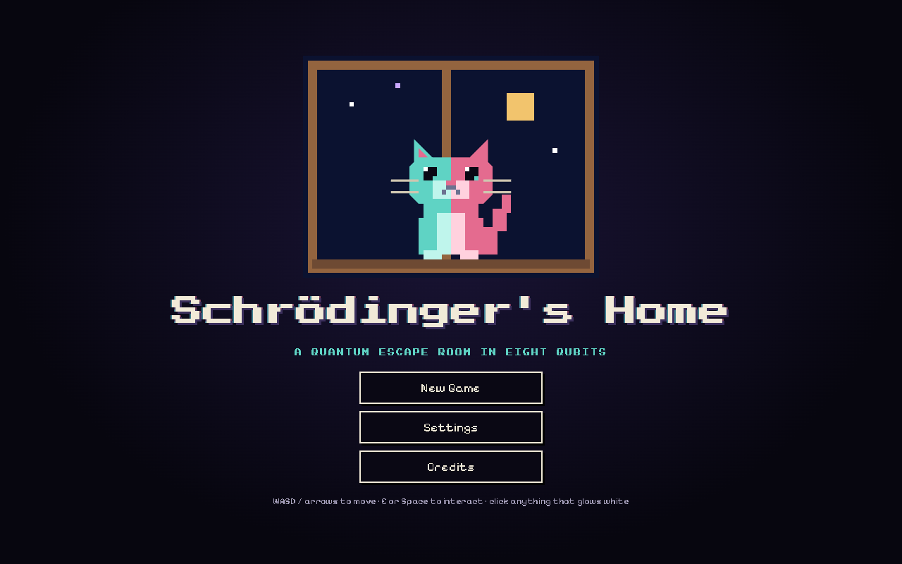

# Schrödinger's Home

*A 2D pixel-art quantum escape room in eight qubits.*



You live in Suite 8. Each time you walk in from the hallway, the gramophone plays **one note**: one fresh copy of the same hidden 8-qubit quantum state, measured once. The household objects (window, closet, trash, couch, clock, lamp, juice bottle, radiator) *are* the measured qubits. Map them, decode the music, discover the XOR constraints, find the hidden **Hadamard's Harmonics™** cartridge to hear the phase that ordinary notes can never reveal, and play the vault its sixteen-note melody, from rarest to most probable, with the right closing chord. Then find out what the qubit that was always 1 really was.

Everything quantum runs on a **from-scratch TypeScript statevector simulator** (256 complex amplitudes, real unitary gates, the Born rule, projective collapse). It is cross-checked against Qiskit. No server, account, network or quantum backend is needed.

---

## Quick start

```bash
npm install
npm run dev          # http://localhost:5173
npm test             # 56 unit/logic/quantum tests (Vitest)
npm run build        # type-check + production build to dist/
npm run preview      # serve the production build
npm run experiments  # regenerate experiments/sample-log.json + results.md from the engine
npm run smoke        # drive the real game in Chrome (Playwright) + screenshots
```

Requirements: Node 18+ (tested on Node 25). `npm run smoke` uses your installed Google Chrome (or set `CHROME_PATH`). The game itself runs fully offline after `npm install`: fonts are bundled and all art and sound are generated locally.

Optional Qiskit cross-check (not needed to play): `python scripts/qiskit_reference.py` (tested with Qiskit 1.4.2).

## Controls

| Action | Keyboard | Mouse / touch |
|---|---|---|
| Move | WASD / arrow keys | on-screen pad (touch or narrow screens) |
| Interact with the nearest glowing object | E or Space | click / tap any object with a white outline |
| Dialogue: finish line / continue | E, Space, Enter | click the box |
| Notebook · Inventory · Hints | N · I · H | top-right buttons |
| Pause / settings / close | Esc | ⚙ |
| Debug hitboxes (debug mode) | `` ` `` | |

Settings: master/music/effects/notes volume, mute, reduced motion, text speed, on-screen controls, fullscreen, save, new game.

## What is playable

The whole story, from the title screen to the cat, is playable and tested end to end.

1. **Prologue: The Wrong Song.** Name entry, the first live note, the vault ("What you heard is not what I require."), a forced rewind.
2. **Act I: The House Remembers.** The Survivor's Notebook (match the remembered note to its waveform), one note per loop, household objects that change between loops (the window never closes), the inventory, J's note.
3. **Act II: The Language of Doors.** The hidden L/R route cipher and brass lever (going left first is address 0 and gets only a quiet knock), photo and paper clues, the **Polarity Cabinet** X-gate calibration, and the **editable House Manual** the player fills in.
4. **Act III: The Sound Has Parts.** The **Listening Desk** (compare recordings, flip one wire, label voice/height/breath) and the **Tangled Switchboard** (find the three XOR constraints from your own data: 16 notes, not 128).
5. **Act IV: Hadamard's Harmonics.** The **Fractured Mirror** opens the panel under the record player. SIDE X echo experiments reveal the hidden phase, and with it the major/minor ending.
6. **Act V: The Prime Ledger.** Odds clues hidden in the objects, a ratio-tile puzzle, a multiplication board, and the **Many-Worlds Toaster** (four independent copies per press, after a frequency-vs-certainty quiz).
7. **Finale.** A 16-card vault sequencer (drag, click-swap or arrow keys; audition each card or the whole melody) plus the chord choice. A wrong answer rewinds to the same secret. Then the CAT ending, with alive/dead, the fake reset, the JAMES joke, stats, new game and credits.

### Bedroom minigames and their unlocks

| Room | Minigame / gadget | Unlocks when |
|---|---|---|
| Left | Notebook torn-page waveform match | after the first rewind |
| Left | Polarity Cabinet (drag X/H tiles into a real 1-qubit circuit) | notebook + one object inspected |
| Left | Listening Desk (compare, flip-one-wire audition, label wires) | calibrated + 2 verified manual rows + 3 recordings |
| Left | Which-Path Lantern (partial measurement, optional) | impressions readable + 1 parity rule |
| Left | Closet (sensor + ledger clue), photo, scorched clipping, bookshelf (prism), bedside box (key) | always / side quest |
| Right | Tangled Switchboard (choose lamp + 2 wires, tested against your data; 3 lamp states) | impressions readable + 4 recordings |
| Right | Fractured Mirror (rotate 3 shards; beam progress 0 → 1 → 2 → 3 → latch) | all 3 parity rules |
| Right | Many-Worlds Toaster (2-question quiz, then 4 independent copies per press) | parity + cartridge + 3 echoes |
| Right | Portrait (`RR = third`), poster, sticky note, projector (prism), metronome (key), dresser (cassette) | always / side quest |
| Common | Gramophone (replay, SIDE Z / SIDE X switch), brass lever, hatch → Hadamard's Harmonics, record sleeves → Prime Ledger, 7 sensors | progressive |
| Vault | Sixteen Grooves sequencer + chord | listening + parity + ledger + cartridge |

**Roommate Exchange (optional side quest):** prism → right projector, cassette → left Listening Desk, key → right metronome. Rewards: an extra address clue photo, two archival reference tapes, a duration and odds hint, the **Good Roommate** badge, a clue token and an alternate ending line. The main quest never requires it (tested).

## Project structure

```
src/
  quantum/      complex, gates, statevector, measure, rng, circuit, codebook, model, validation
  game/         timeline (shots/rewind/toaster), interactions, puzzles, progression, navigationCipher,
                session (new game/checkpoints), dialogueFlow, bus, interactable (hover/outline helper),
                scenes/BootScene (asset loading + procedural fallback), scenes/WorldScene (Phaser world)
  data/         dialogue, clues (hint ladders), sensors, interactables, items, photos, roomLayouts
  assets/       manifest.ts (typed asset IDs), procedural.ts (original placeholder art), palette.ts
  sound/        audioEngine (Web Audio), instruments (4 synthesized timbres)
  state/        types, store, initial, persistence (autosave), uiActions
  ui/           App, TitleScreen, Dialogue, Hud, Notebook, Inventory, HintPanel, PhotoModal, Settings,
                Ending, DebugPanel, TouchControls, Effects, minigames/*
  theme/        tokens.css (colours, fonts, sizes)
tests/          quantum, navigation, progression, vault (incl. golden path ×2), qiskit
scripts/        run-experiments.ts, qiskit_reference.py, smoke.mjs, asset-table.ts
public/assets/  optional teammate art / photos / audio (empty: procedural fallback)
experiments/    generated logs (engine + Qiskit)
```

Architecture: **React** owns menus, dialogue, notebook and minigames. **Phaser 3** owns the top-down world (512×288 logical canvas, 16 px tiles, integer scaling). Both read one serialisable game store. Gameplay logic lives in plain TypeScript (`src/game/*`), so the entire golden path is unit-tested without a browser.

## The quantum core, in brief

```
CAT I1 I0 P2 P1 P0 T1 T0  =  1  A  B  C  D  A⊕C  B⊕D  A⊕D
X(CAT) · RY(2atan√r) on A,B,C,D with r = 2,3,5,7 · CZ(A,B) · Z(A) if s=1 · 6 CNOT parity encoders
P(A,B,C,D) = 2^A 3^B 5^C 7^D / 576     (identical for s=0 and s=1)
Echo: undo the CNOTs, keep CZ, H(A), measure A  →  P(0) = 0.2643 (s=0, C major) / 0.7357 (s=1, C minor)
```

Full derivation and caveats: **[QUANTUM_EXPLANATION.md](QUANTUM_EXPLANATION.md)**. Measured results: **[EXPERIMENTS.md](EXPERIMENTS.md)**.

## Replacing art (for the art teammate)

Drop a transparent PNG at the listed path and the dev server reloads. No code changes. Full table of every ID, path, size and anchor: **[ART_REPLACEMENT_GUIDE.md](ART_REPLACEMENT_GUIDE.md)**.

| Replace | Where |
|---|---|
| Player (4 dirs × 4 frames, 16×24) | `public/assets/sprites/player.png` |
| Each sensor state (e.g. window open/closed, closet ajar/latched, …) | `public/assets/sprites/objects/<object>_<state>.png` |
| Gadgets (gramophone, cabinet, switchboard, mirror, toaster, vault, …) | `public/assets/sprites/gadgets/*.png` |
| Items | `public/assets/sprites/items/*.png` |
| Floor/wall tiles | `public/assets/sprites/tiles/*.png` |
| Photos (only shown on click) | `public/assets/photos/james.jpg` etc. (`src/data/photos.ts`) |
| Portraits | `public/assets/portraits/james.png` |
| UI colours and fonts | `src/theme/tokens.css` |
| Positions, hitboxes, collisions | `src/data/roomLayouts.ts` (art-independent) |

The white hover outline is generated from whatever texture is loaded, so replaced art inherits it. This was verified by the smoke test with a real replacement PNG.

## Debugging and the judges' demo

- `?debug=1` opens the judge/developer overlay: seed and phase, measured string, route buffer, Born probabilities vs observed, the circuit, validation checks, hitboxes, teleport, item grants, per-puzzle reset, labelled demo checkpoints, and a copyable bug-report JSON. See **[DEBUGGING.md](DEBUGGING.md)**.
- `?seed=N` pins the seed for a new game (deterministic replays).
- 5-minute presenter script with an archived checkpoint plus a live shot: **[JUDGES_DEMO.md](JUDGES_DEMO.md)**.

## Verification status (actually run)

| Check | Status |
|---|---|
| `npm test`: 56 tests (quantum maths, Qiskit cross-check, route cipher, one-shot rule, echo no-Z rule, toaster, inventory, save/load, vault scoring, golden path for both phases) | ✅ pass |
| `npm run build` (tsc strict + Vite) | ✅ pass |
| `npm run smoke`: 32 checks in real Chrome (boot, fonts offline, integer scaling, keyboard walking, hover outline, click inspect, decor not highlighted, prologue rewind, Left-first knock, notebook puzzle, manual typing, checkpoint + live shot, every minigame rendered, Mirror/Ledger/Toaster/Switchboard solved through their UI, all 8 notebook pages, wrong vault rewind, vault solve, cat ending, phone viewport, sprite + photo replacement) | ✅ pass |
| Qiskit 1.4.2 reproduces probabilities, order and echo values | ✅ |
| Audio by ear | ⚠️ Not verifiable here: the Web Audio graph runs without errors, but no human has listened to the mix yet. |
| Real phones / tablets | ⚠️ Only an emulated 390×844 touch viewport was tested. |
| Human playtest of the 45–90 minute pacing | ⚠️ Not done yet. Pacing is designed, not measured. |

## Rubric compliance

| Criterion | How we meet it |
|---|---|
| **Quantum connection (25%)** | Every mechanic is a quantum rule: one copy → one measurement; the household objects are measured qubits; collapse (the lantern's partial measurement and conditional sampling); CNOT parity encoding (16 supported outcomes); CZ entanglement; a phase invisible to Z but visible to an X-basis interference experiment; Born-rule weights decide the vault order. Nothing is "random theatrics". |
| **Technical understanding / ownership (25%)** | Hand-written statevector engine; derivations in QUANTUM_EXPLANATION (amplitudes, Born rule, reduced-state purity, why the uncomputation is needed, partial measurement, simulation ≠ speed-up); 56 tests; Qiskit cross-check; debug quantum tab. |
| **Creativity (25%)** | Bedroom routes as binary addresses, the house as a measurement apparatus, prime-weighted melody, Hadamard's Harmonics™, the Many-Worlds Toaster, a cat qubit foreshadowed by a window that never closes, the editable House Manual. |
| **Functionality (15%)** | Complete golden path (tested for both phases and two seeds), autosave, rewinds that keep research, three-tier hints for 15 puzzles, a side quest that never gates, procedural fallback for every asset. |
| **UX (5%)** | Undertale-*inspired* (not copied) dialogue box with typewriter text and skip, white outlines on everything actionable, keyboard/mouse/touch, portrait phone camera, reduced motion, text speed, colour-blind-safe sensor descriptions, offline bundled pixel fonts. |
| **GitHub / documentation (5%)** | This README, QUANTUM_EXPLANATION, EXPERIMENTS (with generated logs), ART_REPLACEMENT_GUIDE (generated asset table), DEBUGGING, JUDGES_DEMO. |

## Known limitations

- Art is original **procedural placeholder** pixel art by design, waiting for the art teammate. Music is a simple synthesized ambient drone, not a composed soundtrack.
- No gamepad support (keyboard focus, mouse and touch only).
- The simulation is ideal and noiseless, and uses a seeded classical PRNG. It is a classical simulation of a small circuit, not a quantum speed-up.
- Once the Listening Desk is unlocked it reveals each archived note's full 8-bit "impression". This is a deliberate pacing choice so players do not have to re-survey the house every loop.
- The hidden phase is stored in `localStorage` alongside the save, so it is not tamper-proof (it is a game, not a security boundary).
- Single save slot.

## Team handoff

- **Developers:** gameplay rules live in `src/game/*.ts` and are UI-independent. Add a puzzle with a predicate in `progression.ts` (`P`), a function in `puzzles.ts`, a minigame component in `src/ui/minigames/`, an interactable in `data/interactables.ts` plus a placement in `data/roomLayouts.ts`, and a hint ladder in `data/clues.ts`. Write a test next to the golden path in `tests/vault.test.ts`.
- **Writers:** all text lives in `src/data/dialogue.ts`, `clues.ts`, `items.ts`, `photos.ts`, `sensors.ts`.
- **Artists:** see ART_REPLACEMENT_GUIDE. Use `?debug=1` and `` ` `` to check hitboxes against new art.

## Credits and licences

- Code: the Schrödinger's Home team. Built with AI pair-programming assistance (Claude). The circuit design, its maths and its verification are documented and tested in this repo.
- Fonts (bundled via Fontsource, SIL Open Font License 1.1): **Press Start 2P** by CodeMan38; **Pixelify Sans** by Stefie Justprince.
- Libraries: Phaser 3 (MIT), React (MIT), Vite (MIT), Vitest (MIT), Playwright (Apache-2.0, dev only).
- All sprites and sounds are original procedural creations. No Undertale (or other game) sprites, fonts, music, dialogue or layouts are included. The dialogue box and pacing are inspired by the *feel* of classic story RPGs.

## D107 photo-reference update

The three main rooms now use the supplied suite photographs: pale dorm walls,
wood floors, four-pane bay window and mini hoop, LED strip, photo collage,
whiteboard, four corner desks with tucked-in chairs, three couches, one recliner, red ottoman, mini fridge and green dinosaur
balloon in common; two beds, wood wardrobes, roller blinds, storage and garment
racks in each bedroom. The left room has two blue horizontal beds on opposite walls. The right has a
sage horizontal bed at the top and a vertical bed along the far-right wall.

The floor plan is rotated for the game's view: hallway below, common in the
middle, bay window ahead, bedrooms on either side. Furniture and circulation are
adapted to the 512×288 canvas. The common room has a 28×14-tile floor and each
bedroom a compact 22×11 floor, making common about 62% larger. Two vertical
sofas face each other around the ottoman, with a third couch and recliner completing
the lounge. Chairs are part of the desk sprites to keep circulation clear. Furniture
and player sizes are preserved. The
address-7 sensor is now a sealed/spilled juice bottle on the floor, with an orange stain in the spilled state. The vault door and quantum gadgets remain
fictional gameplay additions. Original photos and resident names are not bundled;
furniture is drawn as original pixel art in `src/assets/dorm.ts`.

For a quick playthrough use `?debug=1&seed=2025`, then **tools → Quick finale · fill
correct score**, or explore via **world → teleport**. All routes, puzzle solutions
and the sixteen-note melody are in [DEBUGGING.md](DEBUGGING.md#quick-play-and-complete-solutions-spoilers).
